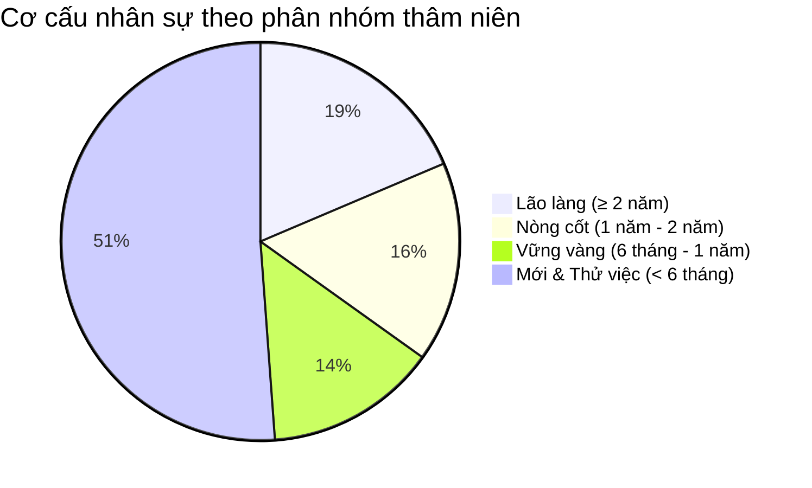

# 🎖️ BẢNG TỔNG HỢP & XẾP HẠNG THÂM NIÊN NHÂN VIÊN COCOMEO SALARY STAFF
*Cập nhật theo dữ liệu thực tế hệ thống • Chỉ bao gồm nhân sự **đang làm việc** (Active)*

---

## 📊 1. Thống Kê Tổng Quan Cơ Cấu Thâm Niên

| Chỉ số | Số liệu | Ghi chú |
| :--- | :---: | :--- |
| **Tổng số nhân viên đang làm việc** | **43 nhân viên** | Phân bổ trên cả 3 chi nhánh (CS1, CS2, CS3) |
| **🥇 Nhân viên thâm niên cao nhất** | **Noa (CS1)** | **39.9 tháng** (~3 năm 4 tháng, từ 01/07/2023) |
| **🥈 Á quân thâm niên** | **Mỹ Mỹ (CS2)** | **32.9 tháng** (~2 năm 9 tháng, từ 28/01/2024) |
| **🥉 Quý quân thâm niên** | **Diễm Phúc (CS3)** | **32.2 tháng** (~2 năm 8 tháng, từ 17/02/2024) |
| **Thâm niên bình quân toàn chuỗi** | **~11.2 tháng** | Mức độ gắn bó trung bình xấp xỉ 1 năm |
| **Phân bổ nhân sự theo chi nhánh** | **CS1: 17 NV** • **CS2: 12 NV** • **CS3: 14 NV** | CS1 có tỷ lệ nhân sự lâu năm cao nhất |

---

## 🏆 2. Bảng Tổng Hợp Chi Tiết Xếp Hạng Thâm Niên (Từ Lớn Đến Thấp)

> [!TIP]
> Danh sách dưới đây được sắp xếp chính xác theo số tháng làm việc thực tế từ cao nhất xuống thấp nhất. Các cột thể hiện chi tiết: Ngày vào làm, Thâm niên (Tháng), Quy đổi năm/tháng, Mức lương/giờ hiện tại và Cơ sở làm việc.

| Hạng | Họ và Tên | Mã NV | Cơ sở | Ngày vào làm | Thâm niên | Quy đổi thời gian | Mức lương/h | Phân nhóm thâm niên |
| :---: | :--- | :---: | :---: | :---: | :---: | :---: | :---: | :---: |
| 🥇 **1** | **Noa** | `Noa` | **CS1** | 01/07/2023 | **39.9 tháng** | 3 năm 4 tháng | 27.000 đ | 🌟 Lão làng (≥ 2 năm) |
| 🥈 **2** | **Mỹ Mỹ** | `Mymy` | **CS2** | 28/01/2024 | **32.9 tháng** | 2 năm 9 tháng | 24.000 đ | 🌟 Lão làng (≥ 2 năm) |
| 🥉 **3** | **Diễm Phúc** | `Diemphuc` | **CS3** | 17/02/2024 | **32.2 tháng** | 2 năm 8 tháng | 26.000 đ | 🌟 Lão làng (≥ 2 năm) |
| **4** | **Mỹ Thanh** | `MyThanh` | **CS2** | 24/08/2024 | **25.9 tháng** | 2 năm 2 tháng | 23.000 đ | 🌟 Lão làng (≥ 2 năm) |
| **5** | **Diễm Quỳnh** | `DiemQuynh` | **CS3** | 01/09/2024 | **25.7 tháng** | 2 năm 2 tháng | 23.000 đ | 🌟 Lão làng (≥ 2 năm) |
| **6** | **Thành Phương** | `Thanhphuong` | **CS1** | 19/09/2024 | **25.1 tháng** | 2 năm 1 tháng | 22.000 đ | 🌟 Lão làng (≥ 2 năm) |
| **7** | **Ý Linh** | `Ylinh` | **CS2** | 16/02/2024 | **24.8 tháng** | 2 năm 1 tháng | 23.000 đ | 🌟 Lão làng (≥ 2 năm) |
| **8** | **Thùy Linh** | `Thuylinh` | **CS2** | 02/10/2024 | **24.6 tháng** | 2 năm 1 tháng | 22.000 đ | 🌟 Lão làng (≥ 2 năm) |
| **9** | **Ngọc Trường** | `Ngoctruong` | **CS1** | 22/02/2024 | **22.8 tháng** | 1 năm 11 tháng | 23.000 đ | 💎 Nòng cốt (1–2 năm) |
| **10** | **Tố Uyên** | `ToUyen` | **CS3** | 22/07/2024 | **22.6 tháng** | 1 năm 11 tháng | 22.000 đ | 💎 Nòng cốt (1–2 năm) |
| **11** | **Mỹ Tâm** | `MyTam` | **CS1** | 01/12/2024 | **22.6 tháng** | 1 năm 11 tháng | 22.000 đ | 💎 Nòng cốt (1–2 năm) |
| **12** | **Thảo Nguyên** | `ThaoNguyen` | **CS3** | 04/03/2025 | **19.5 tháng** | 1 năm 8 tháng | 23.000 đ | 💎 Nòng cốt (1–2 năm) |
| **13** | **Huỳnh Liên** | `HuynhLien` | **CS2** | 17/05/2025 | **17.1 tháng** | 1 năm 5 tháng | 22.000 đ | 💎 Nòng cốt (1–2 năm) |
| **14** | **Thanh Thuỷ** | `Thuy` | **CS2** | 18/09/2025 | **12.9 tháng** | 1 năm 1 tháng | 21.000 đ | 💎 Nòng cốt (1–2 năm) |
| **15** | **Quế Trân** | `Tran` | **CS2** | 22/09/2025 | **12.8 tháng** | 1 năm 1 tháng | 20.000 đ | 💎 Nòng cốt (1–2 năm) |
| **16** | **Phan Lê** | `PhanLe` | **CS1** | 23/02/2025 | **11.5 tháng** | 11.5 tháng | 21.000 đ | 🚀 Vững vàng (6T–1N) |
| **17** | **Thuỳ Trang** | `Thuytrangpc` | **CS1** | 27/12/2025 | **9.6 tháng** | 9.6 tháng | 23.000 đ | 🚀 Vững vàng (6T–1N) |
| **18** | **Diễm Thuý** | `Diemthuy` | **CS3** | 22/12/2025 | **9.5 tháng** | 9.5 tháng | 20.000 đ | 🚀 Vững vàng (6T–1N) |
| **19** | **Kim Tuyên** | `KimTuyen` | **CS1** | 01/01/2026 | **9.4 tháng** | 9.4 tháng | 21.000 đ | 🚀 Vững vàng (6T–1N) |
| **20** | **Lê Sang** | `Lesang` | **CS1** | 27/12/2025 | **8.3 tháng** | 8.3 tháng | 20.000 đ | 🚀 Vững vàng (6T–1N) |
| **21** | **Quốc Khánh** | `Quockhanh` | **CS3** | 09/03/2026 | **7.2 tháng** | 7.2 tháng | 20.000 đ | 🚀 Vững vàng (6T–1N) |
| **22** | **Bách Duy** | `Bachduy` | **CS1** | 21/04/2026 | **5.8 tháng** | 5.8 tháng | 20.000 đ | 🌱 Thử việc / Mới (< 6T) |
| **23** | **Quỳnh Nga** | `QuynhNga` | **CS2** | 04/05/2026 | **5.3 tháng** | 5.3 tháng | 21.000 đ | 🌱 Thử việc / Mới (< 6T) |
| **24** | **Trọng Nghĩa** | `Trongnghia` | **CS3** | 04/05/2026 | **5.3 tháng** | 5.3 tháng | 20.000 đ | 🌱 Thử việc / Mới (< 6T) |
| **25** | **Ngọc Quyên** | `NgocQuyen` | **CS1** | 05/04/2026 | **5.1 tháng** | 5.1 tháng | 20.000 đ | 🌱 Thử việc / Mới (< 6T) |
| **26** | **Hải Âu** | `Haiau` | **CS1** | 07/06/2026 | **4.2 tháng** | 4.2 tháng | 20.000 đ | 🌱 Thử việc / Mới (< 6T) |
| **27** | **Tuấn Khang** | `Tuankhang` | **CS3** | 26/06/2026 | **3.6 tháng** | 3.6 tháng | 19.000 đ | 🌱 Thử việc / Mới (< 6T) |
| **28** | **Phước Ghi** | `Phuocghi` | **CS3** | 27/05/2026 | **3.3 tháng** | 3.3 tháng | 19.000 đ | 🌱 Thử việc / Mới (< 6T) |
| **29** | **Hoàng Mỹ** | `Hoangmy` | **CS1** | 13/07/2026 | **3.0 tháng** | 3.0 tháng | 22.000 đ | 🌱 Thử việc / Mới (< 6T) |
| **30** | **Tấn Dũng** | `Tandung` | **CS3** | 14/07/2026 | **3.0 tháng** | 3.0 tháng | 19.000 đ | 🌱 Thử việc / Mới (< 6T) |
| **31** | **Nhật Tiên** | `Nhattien` | **CS3** | 18/07/2026 | **2.8 tháng** | 2.8 tháng | 19.000 đ | 🌱 Thử việc / Mới (< 6T) |
| **32** | **Ánh Hồng** | `Anhhong` | **CS1** | 20/07/2026 | **2.8 tháng** | 2.8 tháng | 22.000 đ | 🌱 Thử việc / Mới (< 6T) |
| **33** | **Loan Châu** | `Loanchaupc` | **CS2** | 25/07/2026 | **2.6 tháng** | 2.6 tháng | 20.000 đ | 🌱 Thử việc / Mới (< 6T) |
| **34** | **Quỳnh Hương** | `Quynhhuong` | **CS2** | 29/07/2026 | **2.5 tháng** | 2.5 tháng | 19.000 đ | 🌱 Thử việc / Mới (< 6T) |
| **35** | **Minh Thư** | `Minhthu` | **CS2** | 21/06/2026 | **2.4 tháng** | 2.4 tháng | 19.000 đ | 🌱 Thử việc / Mới (< 6T) |
| **36** | **Ngọc Huyền** | `Ngochuyen` | **CS1** | 09/08/2026 | **2.1 tháng** | 2.1 tháng | 19.000 đ | 🌱 Thử việc / Mới (< 6T) |
| **37** | **Ngọc Tài** | `Ngoctai` | **CS1** | 21/08/2026 | **1.7 tháng** | 1.7 tháng | 19.000 đ | 🌱 Thử việc / Mới (< 6T) |
| **38** | **Phương Trinh** | `Phuongtrinh` | **CS3** | 30/08/2026 | **1.4 tháng** | 1.4 tháng | 19.000 đ | 🌱 Thử việc / Mới (< 6T) |
| **39** | **Cao Bảo Ngân** | `Baongan2` | **CS1** | 30/08/2026 | **1.1 tháng** | 1.1 tháng | 19.000 đ | 🌱 Thử việc / Mới (< 6T) |
| **40** | **Thanh Xuân** | `Thanhxuan` | **CS2** | 08/09/2026 | **1.1 tháng** | 1.1 tháng | 19.000 đ | 🌱 Thử việc / Mới (< 6T) |
| **41** | **Minh Thiện** | `Minhthien` | **CS1** | 10/09/2026 | **1.0 tháng** | 1.0 tháng | 19.000 đ | 🌱 Thử việc / Mới (< 6T) |
| **42** | **Phương Thảo** | `Phuongthao` | **CS1** | 11/09/2026 | **1.0 tháng** | 1.0 tháng | 19.000 đ | 🌱 Thử việc / Mới (< 6T) |
| **43** | **Thiện Thành** | `Thienthanh` | **CS2** | 10/09/2026 | **0.8 tháng** | 0.8 tháng | 19.000 đ | 🌱 Thử việc / Mới (< 6T) |

---

## 💡 3. Nhận Xét & Đề Xuất Quản Trị Nhân Sự

1. **Nhóm Lão làng & Nòng cốt (15 người, chiếm ~35%):**
   * Đây là lực lượng nòng cốt giữ chất lượng vận hành và chăm sóc mèo tại cả 3 cơ sở.
   * Tất cả nhân sự trong nhóm này đều có thâm niên $\ge 12$ tháng, mức lương từ 20.000đ - 27.000đ/h và đủ điều kiện nhận các chính sách thưởng trung thành, sinh nhật (100.000đ khi thâm niên $\ge 6$ tháng).
2. **Nhóm Nhân sự mới & Thử việc (22 người, chiếm ~51%):**
   * Chuỗi đang tiếp nhận nhiều nhân sự mới (dưới 6 tháng) có mức lương khởi điểm từ 19.000đ - 20.000đ/h.
   * Nên phân công các nhân sự Top đầu (như Noa, Mỹ Mỹ, Diễm Phúc, Mỹ Thanh) kèm cặp để đảm bảo đúng tiêu chuẩn phục vụ và quy trình vệ sinh của quán.
